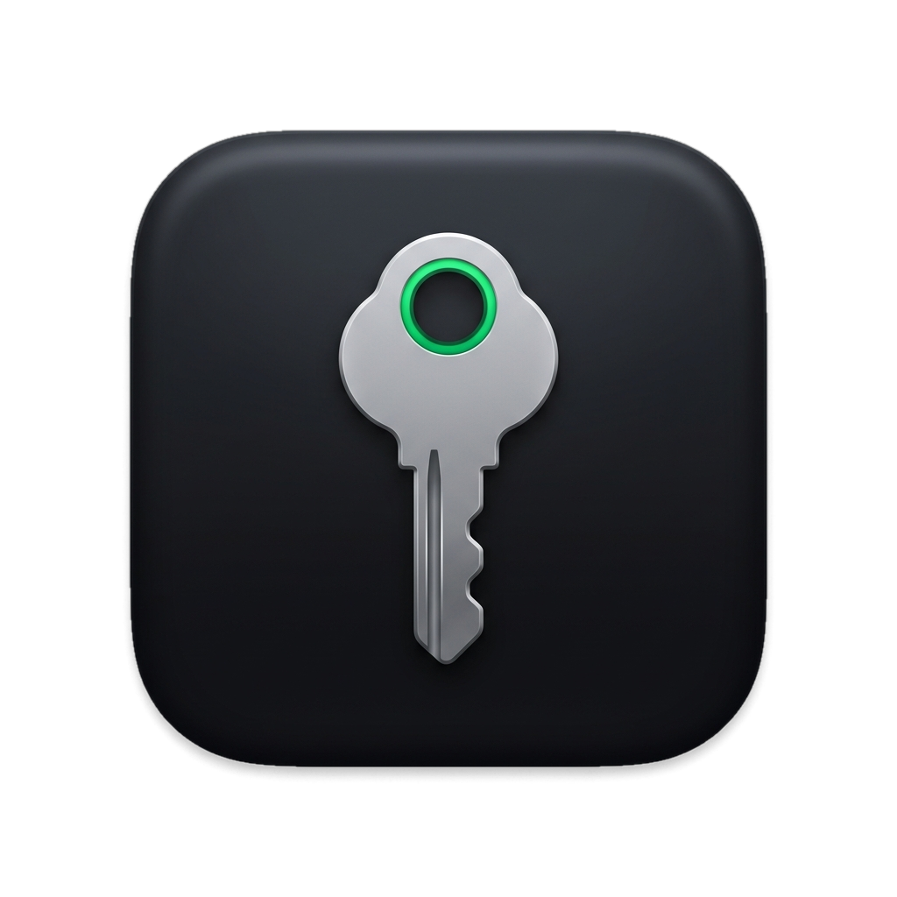
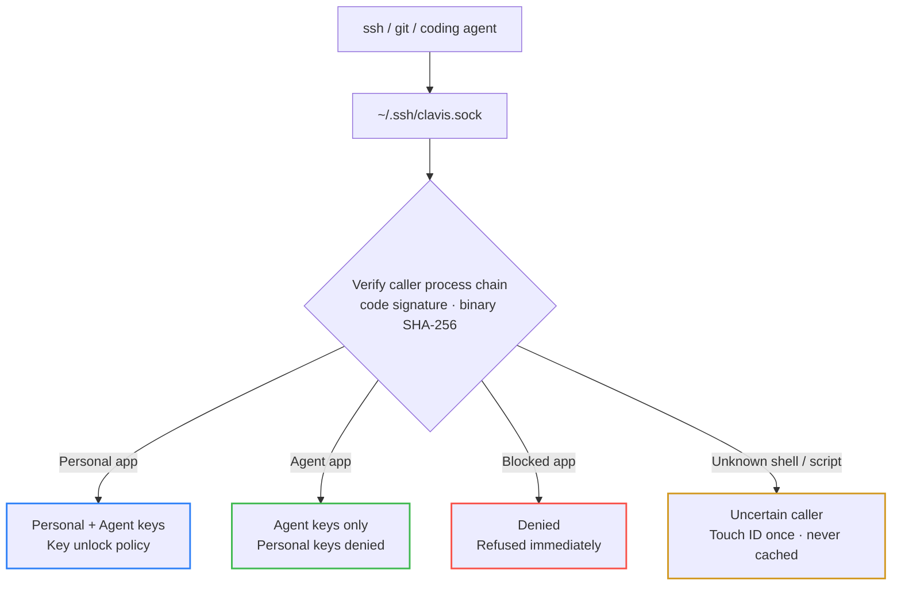

<div align="center">
  
  <h1>Clavis</h1>
  <p><strong>Agent-safe Secure Enclave SSH key manager for macOS.</strong></p>
  <p>
    <a href="#why-clavis">Why Clavis</a> ·
    <a href="#how-caller-verification-works">How it works</a> ·
    <a href="#install">Install</a> ·
    <a href="#how-clavis-compares">Compare</a> ·
    <a href="#security">Security</a> ·
    <a href="docs/BUILDING.md">Build</a>
  </p>
</div>

<!-- TODO: Add hero screenshot (16:9) -->

## Why Clavis

Modern coding agents (`claude`, `codex`, Cursor, CI scripts) run `git` and `ssh` in your local shell. A traditional `ssh-agent` gives every process in that session the same ambient authority over your personal SSH keys.

Clavis generates ECDSA P-256 keys inside the Apple Secure Enclave and separates **Personal** keys from **Agent** keys using macOS code-signing verification on the requesting process tree.

## How Caller Verification Works



- **Keys stay in silicon:** ECDSA P-256 private keys are generated in and never leave the Secure Enclave; the encrypted recovery vault (`~/.config/clavis/vault`) is itself sealed by a Secure Enclave master key.
- **Least-privilege capabilities:** Each key has independent **SSH** and **Signature** (`SSHSIG`) switches, configurable unlock policies (Touch ID, Apple Watch, or macOS password), zero-prompt `ssh-add -l`, and caller path & PID attribution in the Notch prompt.
- **Scoped agent guardrails:** Agent keys support bounded leases, per-key host allowlists, token-bucket rate limits, `ask` / `notify` / `none` modes, and forwarded-agent detection (`session-bind@openssh.com`).
- **Kill Switch & audit trail:** Pause both sockets and revoke active grants from the Menu Bar at any time; every decision is recorded in an encrypted local audit log.

## Install

| Channel | Install |
|:---|:---|
| 🍺 **Homebrew** | `brew install --cask clavis` |
| ❄️ **Nix Flake** | `nix profile install github:GDR/clavis` |
|  **Mac App Store** | [**Download on the Mac App Store →**](#) |
| 📦 **Direct DMG** | [**`clavis-macos-arm64.dmg` →**](https://github.com/GDR/clavis/releases) |

<!-- TODO: Add Mac App Store URL -->

> [!NOTE]
> Requires **macOS 15+** and a Mac with Secure Enclave hardware (Apple silicon, Intel T2, or 2016–2017 MacBook Pro with Touch Bar).

<details>
<summary>Verify DMG build provenance</summary>

```bash
gh attestation verify clavis-macos-arm64.dmg --repo GDR/clavis
```

</details>

## Configure SSH & Git

```sshconfig
# ~/.ssh/config
Host github.com
  IdentityAgent ~/.ssh/clavis.sock
  IdentitiesOnly yes
  IdentityFile ~/.ssh/clavis/personal.pub
```

```bash
# Git commit signing
git config --global gpg.format ssh
git config --global user.signingkey "$(cat ~/.ssh/clavis/personal.pub)"
git commit -S -m "initial signed commit"
```

For multi-commit rebases or cherry-picks, Clavis can offer an opt-in 5-minute / 200-operation signing session bound to `ssh-keygen`, its parent `git` process, and process group.

## How Clavis Compares

| Capability | OpenSSH `ssh-agent` | Secretive | 1Password SSH Agent | **Clavis** |
|:---|:---:|:---:|:---:|:---:|
| **Hardware keys** | —<br><sub>Software / disk (or FIDO2 key)</sub> | ✅ **Secure Enclave**<br><sub>ECDSA P-256</sub> | —<br><sub>Encrypted vault (cloud / local)</sub> | ✅ **Secure Enclave**<br><sub>ECDSA P-256 + SE-sealed vault</sub> |
| **Caller verification** | —<br><sub>Any local socket client</sub> | ◐ **Prompt label**<br><sub>Process info shown</sub> | ◐ **App prompt**<br><sub>Session-based</sub> | ✅ **Code-signed chain**<br><sub>Personal / Agent / Block / Uncertain</sub> |
| **Agent key isolation** | —<br><sub>Shared key pool</sub> | —<br><sub>Single-user keys</sub> | —<br><sub>Shared vault keys</sub> | ✅ **Personal vs. Agent**<br><sub>Agent callers denied Personal keys</sub> |
| **SSH vs. Git (`SSHSIG`)** | —<br><sub>Combined</sub> | —<br><sub>Combined</sub> | —<br><sub>Combined</sub> | ✅ **Independent toggles**<br><sub>Per-key SSH & Signature switches</sub> |
| **Agent guardrails** | ◐ **Timeout (`-t`)**<br><sub>Global key TTL</sub> | ◐ **Prompt / TTL**<br><sub>Single-user</sub> | ◐ **Per-session**<br><sub>App approval</sub> | ✅ **Scoped policies**<br><sub>Leases, host allowlists & rate limits</sub> |
| **Kill Switch & audit** | ◐ `ssh-add -D`<br><sub>Drops loaded keys</sub> | ◐ **Remove / lock**<br><sub>Manual</sub> | ◐ **Lock app**<br><sub>Vault lock</sub> | ✅ **Persistent Kill Switch**<br><sub>Instant revoke + encrypted audit log</sub> |

## Security

Clavis enforces hardware non-exportability via the Secure Enclave and application-level caller policies on top. Same-user caller classification and socket policies are guardrails, not a kernel sandbox against hostile code already running under your macOS user account.

- [SECURITY.md](SECURITY.md) — threat model, forwarding semantics, and release verification
- [docs/personal-bot-routing.md](docs/personal-bot-routing.md) — caller routing, capability switches, and revocation guarantees
- [docs/BUILDING.md](docs/BUILDING.md) — local builds, signing identities, Keychain scopes, and CI notarization
